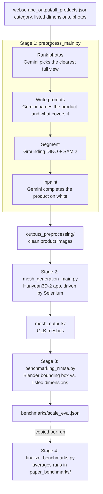

# PreviewAR

PreviewAR turns online furniture listings into textured 3D models (`.glb`) for previewing products in AR. For each product, the pipeline picks the best listing photo, removes anything resting on or covering the product, generates a clean image of the product alone on a white background, and converts that image into a textured mesh with [Hunyuan3D-2](https://github.com/Tencent-Hunyuan/Hunyuan3D-2). An evaluation step then compares each mesh's proportions with the dimensions given in the listing.

## Pipeline overview



| Stage | Command | Reads | Writes |
|---|---|---|---|
| 1. Preprocess | `python preprocess_main.py` | `webscrape_output/all_products.json` | `outputs_preprocessing/` |
| 2. Generate meshes | `python mesh_generation_main.py` | `outputs_preprocessing/impainted_images.json` | `mesh_outputs/` |
| 3. Evaluate scale | `python benchmarking_rrmse.py` | `mesh_outputs/meshes.json` | `benchmarks/scale_eval.json` |
| 4. Summarize runs | `python finalize_benchmarks.py` | `paper_benchmarks/run#*/` | `paper_benchmarks/benchmark_summary.json` |

The input, `webscrape_output/all_products.json`, lists each product's category, listed dimensions in inches, and downloaded photos. The web scraper that builds it isn't included in this repository. **If you'd like to use it, email [davinkyi@gmail.com](mailto:davinkyi@gmail.com).** Otherwise, [webscrape_output/](webscrape_output/) documents the format so you can produce the file with your own scraper.

### Stage 1: Preprocess

`preprocess_main.py` loads Grounding DINO and SAM 2 once, then for each product:

1. **Rank photos.** Gemini (`gemini-3.1-pro-preview`) compares all of the product's photos and picks the one that best shows the whole object in its normal configuration, with the least obstruction and the most visible faces.
2. **Write prompts.** Gemini (`gemini-3.1-flash-lite-preview`) returns a positive prompt naming the product (e.g. `couch.`) and a negative prompt listing objects resting on or covering it (e.g. `pillow. blanket.`).
3. **Segment.** Grounding DINO and SAM 2 locate the product and the covering objects. The photo is cropped to the product, and a composite is built with the product's pixels kept, covering objects painted white, and the background black.
4. **Inpaint.** Gemini's image model (`gemini-3-pro-image-preview`) fills in the hidden parts of the product and places it alone on a white background.

Steps 1–2 live in [WebScrape_Processing/](WebScrape_Processing/), step 3 in [Image_Processing/](Image_Processing/), and step 4 in [Impaint_Processing/](Impaint_Processing/). Each result is saved as `outputs_preprocessing/impainted_images/<name>.png`.

### Stage 2: Generate meshes

`mesh_generation_main.py` drives the Hunyuan3D-2 Gradio app with Selenium. For each clean image, it uploads the image, sets *Target Face Number* (default 1,000,000), clicks **Gen Textured Shape**, and waits for the app to write `textured_mesh.glb` to its cache folder. Once that file is complete and valid, it's copied to `mesh_outputs/glbs/<object_type>__<name>.glb`.

### Stage 3: Evaluate scale

`benchmarking_rrmse.py` runs Blender headless with [`utils/blender_bbox.py`](utils/) to measure each mesh's bounding box, and compares it with the listed dimensions. The meshes aren't generated at real-world scale, so the headline metric compares proportions: each set of dimensions is sorted largest-first and divided by its largest value, and the relative RMSE (RRMSE) between the two is reported as a percentage. See [benchmarks/](benchmarks/).

### Stage 4: Summarize runs

`finalize_benchmarks.py` averages the per-product runtimes of stages 1 and 2, and the RRMSE, for each `paper_benchmarks/run#N/` folder and across all runs. See [paper_benchmarks/](paper_benchmarks/).

### Names and re-runs

- Products are named `<object_type>#<n>`, numbered in input order within each category (`bed#1`, `bed#2`, …). Stage 1 recomputes these names from the order of `all_products.json` on every run, so append new products rather than reordering or removing existing ones.
- Meshes are saved as `<object_type>__<name>.glb`, e.g. `bed__bed#1.glb`.
- Stages 1 and 2 skip products whose output file already exists, so an interrupted run can simply be restarted. Delete an output to regenerate it.
- Stage 1 rewrites its JSON files on each run. Stage 2 appends to its JSON files, so regenerating a mesh leaves an extra record for that product in `meshes.json`; see [mesh_outputs/](mesh_outputs/).

## Repository layout

### Code

| Path | Purpose |
|---|---|
| `preprocess_main.py` | Stage 1 entry point |
| `mesh_generation_main.py` | Stage 2 entry point |
| `benchmarking_rrmse.py` | Stage 3 entry point |
| `finalize_benchmarks.py` | Stage 4 entry point |
| [WebScrape_Processing/](WebScrape_Processing/) | Photo ranking and prompt writing (Gemini), plus a single-URL product scraper (Selenium + GPT-5) |
| [Image_Processing/](Image_Processing/) | Grounding DINO + SAM 2 segmentation and inpainting composites |
| [Impaint_Processing/](Impaint_Processing/) | Gemini inpainting |
| [Mesh_Processing/](Mesh_Processing/) | Hunyuan3D-2 run in-process (used by `main.py`, not by stage 2) |
| [utils/](utils/) | Blender scripts (bounding box, GLB grid viewer) and small helpers |
| `grounded_sam2/` | [Grounded-SAM-2](https://github.com/IDEA-Research/Grounded-SAM-2), third-party; empty in a fresh clone (see [Setup](#setup)) |
| `hunyuan/` | [Hunyuan3D-2](https://github.com/Tencent-Hunyuan/Hunyuan3D-2), third-party; empty in a fresh clone (see [Setup](#setup)) |

### Data and results

| Path | Contents |
|---|---|
| [webscrape_output/](webscrape_output/) | Pipeline input: products and their photos |
| [outputs_preprocessing/](outputs_preprocessing/) | Stage 1 output: clean product images and runtimes |
| [sam_outputs/](sam_outputs/) | Stage 1 scratch: segmentation results for the most recent photo |
| `uploads/` | Stage 1 scratch: Gemini saves each result here as `inpainted_result.png`. Keep other files out of this folder, because stage 1 takes the newest file in it as the result. |
| [mesh_outputs/](mesh_outputs/) | Stage 2 output: GLBs and runtimes |
| [benchmarks/](benchmarks/) | Stage 3 output |
| [paper_benchmarks/](paper_benchmarks/) | Three full runs on the same 50 products, and their summary |
| [backblaze_glbs/](backblaze_glbs/) | The GLBs from those three runs |
| [cache/](cache/) | Stage 1 and stage 2 outputs from run 3, ready to reuse |

The checked-in contents of `webscrape_output/`, `outputs_preprocessing/`, `sam_outputs/`, and `mesh_outputs/` come from small test runs.

## Setup

You'll need Linux with an NVIDIA GPU (SAM 2 and Hunyuan3D-2 run on CUDA), Python 3.10 or newer, Google Chrome for Selenium (which downloads a matching driver itself), and Blender on your `PATH` for stage 3.

**1. Python packages.** Install a CUDA build of [PyTorch](https://pytorch.org/get-started/locally/) first, then:

```bash
pip install -r requirements.txt -r Image_Processing/requirements.txt -r WebScrape_Processing/requirements.txt
```

**2. Third-party repositories.** `grounded_sam2/` and `hunyuan/` are recorded as plain gitlinks with no `.gitmodules` file, so cloning this repository (even with `--recursive`) leaves them empty. Clone them at the pinned commits:

```bash
git clone https://github.com/IDEA-Research/Grounded-SAM-2.git grounded_sam2
git -C grounded_sam2 checkout b7a9c29f196edff0eb54dbe14588d7ae5e3dde28

git clone https://github.com/Tencent-Hunyuan/Hunyuan3D-2.git hunyuan
git -C hunyuan checkout f8db63096c8282cb27354314d896feba5ba6ff8a
```

- **Grounded-SAM-2:** install SAM 2 (`pip install -e grounded_sam2`) and download its checkpoints (`cd grounded_sam2/checkpoints && bash download_ckpts.sh`); the pipeline uses `sam2.1_hiera_large.pt`. Grounding DINO is loaded through Hugging Face `transformers` (`IDEA-Research/grounding-dino-tiny`) and downloads on first use.
- **Hunyuan3D-2:** follow its README to install its requirements, the `hy3dgen` package, and the two texture extensions under `hy3dgen/texgen/`.

The copies used to produce the results in this repository have local edits on top of those commits:

- `grounded_sam2`: SAM 2's internal imports are changed from `sam2.…` to `grounded_sam2.sam2.…` so it can be imported as `grounded_sam2.sam2`, as `Image_Processing/` does. `sam2/build_sam.py` also aliases `sam2` to `grounded_sam2.sam2` before Hydra builds the model, so config targets such as `sam2.modeling.sam2_base.SAM2Base` still resolve. An empty `grounded_sam2/__init__.py` is added.
- `hunyuan`: in `hy3dgen/texgen/differentiable_renderer/mesh_render.py`, `MeshRender` casts vertex positions to `float` and face indices to `int` before rasterizing.

**3. API keys.** Create a `.env` file in the repository root (it's git-ignored):

```bash
GEMINI_API_KEY=...   # stage 1: photo ranking, prompts, inpainting
OPENAI_API_KEY=...   # only for the single-URL scraper, main.py, and rag_products.py
```

Modules load it with python-dotenv, which searches upward from each module's own folder. A `.env` inside a subfolder is therefore used instead of the root one by the modules in that folder.

## Running

Run everything from the repository root.

```bash
# Stage 1 -> outputs_preprocessing/
python preprocess_main.py --clear-uploads-between-items \
    --sam2-checkpoint grounded_sam2/checkpoints/sam2.1_hiera_large.pt

# Stage 2: in a second terminal, start the Hunyuan3D-2 app from inside hunyuan/.
# It serves http://127.0.0.1:8080 and writes to hunyuan/gradio_cache/,
# which are mesh_generation_main.py's defaults.
cd hunyuan && python gradio_app.py

# Then, back in the repository root -> mesh_outputs/
python mesh_generation_main.py

# Stage 3 -> benchmarks/scale_eval.json
python benchmarking_rrmse.py
```

- **Always pass `--clear-uploads-between-items`.** Stage 1 takes the newest file in `uploads/` as each product's inpainting result. Without this flag, if Gemini returns no image, the previous product's result is still the newest file and gets saved under the current product's name.
- `--sam2-checkpoint` defaults to an absolute path on the original development machine.
- `gradio_app.py` takes model options (`--model_path`, `--subfolder`, `--low_vram_mode`, …); see `hunyuan/README.md`. Texture generation must be available, because the app hides **Gen Textured Shape** without it.
- `mesh_generation_main.py --headless 1` hides the browser window, and `--target_faces` sets the face count.
- `benchmarking_rrmse.py` has no command-line options. To change its input or output paths, edit the defaults of `evaluate()`.
- To record a benchmark run, copy `outputs_preprocessing/preprocessing_runtime.json`, `mesh_outputs/runtimes.json`, and `benchmarks/scale_eval.json` into a new `paper_benchmarks/run#N/` folder, then run `python finalize_benchmarks.py`.

## Other scripts and files

| Path | What it is |
|---|---|
| `main.py` | The original single-URL pipeline: scrape a product page, pick a photo, segment, inpaint, generate the mesh with `Mesh_Processing/`, and save metadata to `outputs/metadata/dimensions.json`. **Doesn't run as-is:** importing `WebScrape_Processing/webscrape_processing.py` fails (see [WebScrape_Processing/](WebScrape_Processing/)), and the mesh step uses an older `generate_glb_from_image()` signature. |
| `rag_products.py` | Embeds the products that `main.py` saved to `outputs/metadata/dimensions.json` with OpenAI embeddings (stored in `index.json`), then finds GLBs that match a text query within maximum dimensions and writes them to `outputs/relevant_glbs.json`. When run as a script, it opens the matches in Blender with `utils/view_glbs.py`. |
| `run_blender.py` | Converts a GLB to a `.blend` file and opens it in Blender. Paths are hard-coded. |
| `get_counts.py` | Counts `mesh_outputs/meshes.json` records by `description` and `site`. Current records don't have these fields, so every record is counted as `UNKNOWN`. |
| `update_script.py` | Prints the number of meshes per object type. Its default input, `mesh_outputs/meshes_minimal.json`, isn't in the repository; pass `--input-json mesh_outputs/meshes.json`. |
| `index.json` | Embedding index written by `rag_products.py`. |
| `backblaze_glbs.json` | A `meshes.json`-style list of 40 GLBs, referenced by file name; see [backblaze_glbs/](backblaze_glbs/). |
| `page.html`, `page_filtered.html` | Product-page HTML saved by the single-URL scraper. |
| `image.png` | Sample input for the demo in `Impaint_Processing/nano_banana.py`. |
